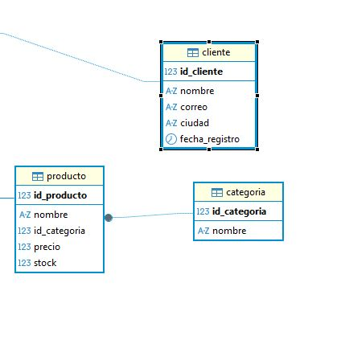

# ApiEjemplo – API REST Tienda (.NET 10 + MySQL)

API REST de ejemplo creada con **ASP.NET Core (.NET 10)** y **MySQL** que implementa el CRUD completo de las tablas del diagrama de la base de datos:

- `categoria`: `id_categoria`, `nombre`
- `cliente`: `id_cliente`, `nombre`, `correo`, `ciudad`, `fecha_registro`
- `producto`: `id_producto`, `nombre`, `id_categoria`, `precio`, `stock`

La tabla `producto` fue ajustada a los campos del diagrama y se relaciona con `categoria` mediante la llave foránea `id_categoria`.

## Diagrama de la base de datos



## Estructura del proyecto

```text
ApiEjemplo/
├── Controllers/
│   ├── CategoriaController.cs   -> CRUD /categoria
│   ├── ClienteController.cs     -> CRUD /cliente
│   ├── ProductoController.cs    -> CRUD /producto
│   └── SaludController.cs       -> GET /salud (diagnóstico)
├── Models/
│   ├── Categoria.cs
│   ├── Cliente.cs
│   └── Producto.cs
├── database/
│   ├── 01_crear_base_datos.sql     -> crea la base de datos y las tablas
│   ├── 02_migracion_producto.sql   -> ajusta una tabla producto existente
│   └── 03_datos_ejemplo.sql        -> datos de prueba
├── docs/diagrama-bd.png
├── ApiEjemplo.csproj
├── Program.cs
├── appsettings.json
└── ApiEjemplo.http
```

## Requisitos

- [.NET SDK 10.0](https://dotnet.microsoft.com/download) o superior
- MySQL 8.0 o superior (XAMPP, WAMP, MySQL Installer, etc.)

## 1. Crear / ajustar la base de datos

### Opción A – Base de datos nueva

Ejecuta los scripts en este orden:

```bash
mysql -u root -p < database/01_crear_base_datos.sql
mysql -u root -p < database/03_datos_ejemplo.sql
```

También puedes abrirlos y ejecutarlos desde MySQL Workbench, phpMyAdmin o DBeaver.

### Opción B – Ya existe la tabla `producto` con columnas en inglés

Si tu tabla `producto` tiene la estructura anterior (`id`, `name`, `price`, `quantity`), ejecuta primero el script de creación de la base y la tabla `categoria`, y después:

```bash
mysql -u root -p < database/02_migracion_producto.sql
```

Ese script renombra las columnas a `id_producto`, `nombre`, `precio`, `stock` y agrega la llave foránea `id_categoria` hacia `categoria`.

> La tabla quedó con los campos del diagrama: **id_producto, nombre, id_categoria, precio, stock**.

## 2. Configurar la cadena de conexión

Edita `appsettings.json` y ajusta los datos de tu servidor MySQL:

```json
"ConnectionStrings": {
  "Tienda": "Server=localhost;Port=3306;Database=tienda;User ID=root;Password=12345;"
}
```

Si tu usuario o contraseña son distintos, cambia `User ID` y `Password`. También puedes sobreescribirla con una variable de entorno:

```bash
export ConnectionStrings__Tienda="Server=localhost;Port=3306;Database=tienda;User ID=root;Password=tu_password;"
```

## 3. Ejecutar la API

```bash
dotnet restore
dotnet run
```

La API queda disponible en `http://localhost:5156`. El documento OpenAPI (solo en desarrollo) está en `http://localhost:5156/openapi/v1.json`.

## 4. Endpoints

### Categoría

| Método | Ruta                | Descripción                              |
| ------ | ------------------- | ---------------------------------------- |
| GET    | `/categoria`        | Lista todas las categorías               |
| GET    | `/categoria/{id}`   | Obtiene una categoría por id             |
| POST   | `/categoria`        | Crea una categoría                       |
| PUT    | `/categoria/{id}`   | Actualiza una categoría                  |
| DELETE | `/categoria/{id}`   | Elimina una categoría                    |

### Cliente

| Método | Ruta              | Descripción                          |
| ------ | ----------------- | ------------------------------------ |
| GET    | `/cliente`        | Lista todos los clientes             |
| GET    | `/cliente/{id}`   | Obtiene un cliente por id            |
| POST   | `/cliente`        | Crea un cliente                      |
| PUT    | `/cliente/{id}`   | Actualiza un cliente                 |
| DELETE | `/cliente/{id}`   | Elimina un cliente                   |

### Producto

| Método | Ruta               | Descripción                                      |
| ------ | ------------------ | ------------------------------------------------ |
| GET    | `/producto`        | Lista los productos con el nombre de su categoría|
| GET    | `/producto/{id}`   | Obtiene un producto por id                       |
| POST   | `/producto`        | Crea un producto                                 |
| PUT    | `/producto/{id}`   | Actualiza un producto                            |
| DELETE | `/producto/{id}`   | Elimina un producto                              |

### Diagnóstico

| Método | Ruta     | Descripción                                |
| ------ | -------- | ------------------------------------------ |
| GET    | `/salud` | Comprueba la conexión con MySQL            |

## 5. Ejemplos de uso

Crear una categoría:

```bash
curl -X POST http://localhost:5156/categoria \
  -H "Content-Type: application/json" \
  -d '{"nombre":"Computadores"}'
```

Crear un cliente:

```bash
curl -X POST http://localhost:5156/cliente \
  -H "Content-Type: application/json" \
  -d '{"nombre":"Ana María Gómez","correo":"ana.gomez@correo.com","ciudad":"Medellín"}'
```

Crear un producto:

```bash
curl -X POST http://localhost:5156/producto \
  -H "Content-Type: application/json" \
  -d '{"nombre":"Portátil HP 15","idCategoria":1,"precio":2450000,"stock":10}'
```

Actualizar y eliminar:

```bash
curl -X PUT http://localhost:5156/categoria/1 \
  -H "Content-Type: application/json" \
  -d '{"nombre":"Computadores y portátiles"}'

curl -X DELETE http://localhost:5156/cliente/1
```

Los cuerpos JSON en `camelCase` coinciden con las propiedades de los modelos: los nombres de columna en la base de datos son `snake_case` (`id_categoria`, `fecha_registro`, etc.).

### Códigos de respuesta

- `200 OK` / `201 Created` / `204 No Content` en operaciones correctas.
- `400 Bad Request` cuando faltan datos obligatorios.
- `404 Not Found` cuando el registro no existe.
- `409 Conflict` cuando se duplica un nombre de categoría o un correo de cliente, o cuando no se puede eliminar una categoría con productos asociados.

## Autor

Trabajo desarrollado como ejemplo de API REST con ASP.NET Core y MySQL.
